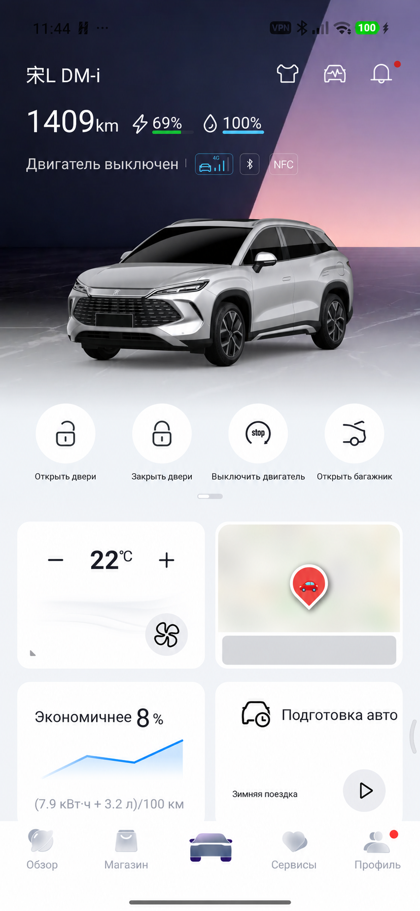
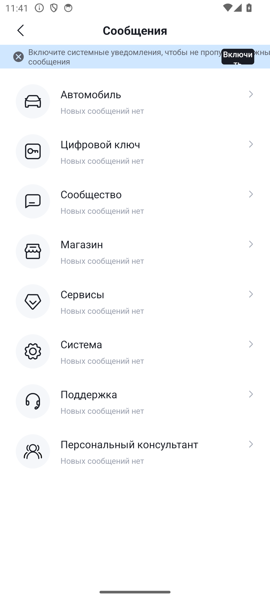
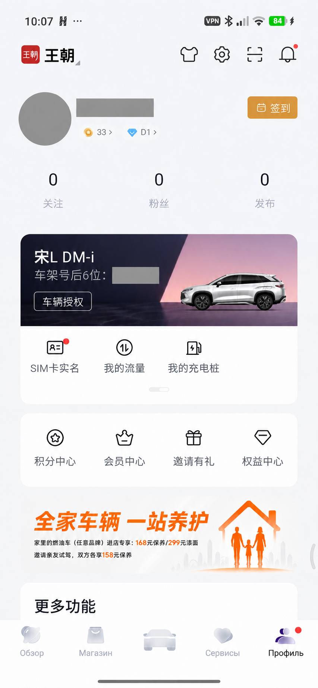
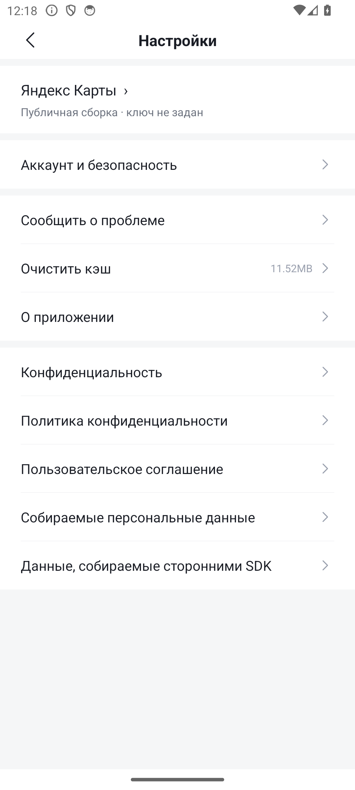
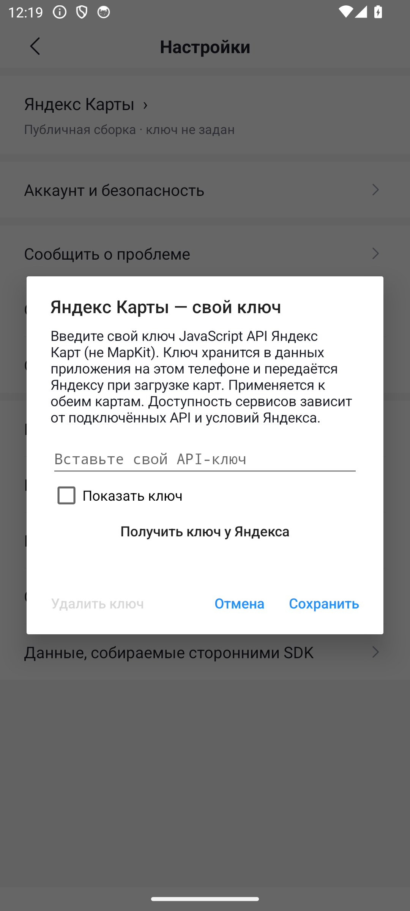

# BYD — русский интерфейс и Яндекс Карты

Неофициальная модификация Android-приложения BYD для **телефона**.
Это не прошивка автомобиля и не приложение для установки в DiLink.

В репозитории размещена только инструкция, а готовый APK — в Releases. Исходный код приложения здесь не публикуется.

## Скачать

### Новая тестовая сборка Font14v2 — карта на главной и обновлённые подписи

[Скачать APK — Font14v2](https://github.com/hix83/BYD-RU-Yandex/releases/download/v9.18.1-font14v2/BYD_9.18.1_RU_Yandex_OSM_Font14v2.apk)

[Описание обновления и файлы](https://github.com/hix83/BYD-RU-Yandex/releases/tag/v9.18.1-font14v2)

- Добавлена карта в карточку **«Картографический сервис»** на главной странице. Она использует выбранный движок — Яндекс или OpenStreetMap.
- Стабилизирован перевод: итоговые русские подписи применяются до отрисовки, чтобы убрать переключение с китайского текста на длинный перевод и затем на сокращения. Это не означает, что переведены все серверные материалы и изображения.
- У всех команд автомобиля установлен одинаковый шрифт **14 sp**, без автоматического уменьшения и горизонтального сжатия. Короткие подписи сохранены: «ОТКР. ДВ.», «ЗАКР. ДВ.», «ВЫКЛ. ДВИГ.» и другие. Подписи окон, света и сигнала также сокращены, чтобы не накладываться друг на друга.
- Сохранены исправления первого запуска и экрана входа из StartupFix2. Поиск Яндекса сохранён; поиска объектов в OpenStreetMap по-прежнему нет.

Именно этот APK установлен и проверен на Xiaomi: обновление поверх без очистки данных, вход в аккаунт и ключ Яндекса сохранены, мини-карта загружается. На эмуляторе проверены 12 вариантов подписей: все остаются ровно 14 sp при изменении ширины и обновлении текста. Команды автомобилю при проверке не отправлялись.

**Нужна проверка Font14v2 на Honor 90 и Infinix 40:** первый запуск, принятие соглашения, открытие формы входа и вход в свой аккаунт. На этих моделях новая сборка ещё не проверена. Сообщите модель, версию Android, имя APK и этап возможного вылета.

Путь настройки: **Профиль → ⚙ Настройки → Карты — Яндекс / OpenStreetMap**. Параметры и пояснения движков разделены; подробнее — [ниже](#yandex-key).

При обновлении не удаляйте приложение и не очищайте данные. Если Android сообщает о конфликте подписи, остановитесь. Личный ключ автора в APK не встроен; исходники и данные аккаунтов не публикуются.

### Предыдущая тестовая сборка StartupFix2 — исправление запуска и входа

[Скачать исправленный APK — StartupFix2](https://github.com/hix83/BYD-RU-Yandex/releases/download/v9.18.1-startupfix2/BYD_9.18.1_RU_Yandex_OSM_StartupFix2.apk)

[Описание исправлений и инструкция для этой сборки](https://github.com/hix83/BYD-RU-Yandex/releases/tag/v9.18.1-startupfix2)

StartupFix2 оставлена для сравнения и отката; для новой проверки на Honor 90 и Infinix 40 скачивайте Font14v2 выше.

StartupFix2 сохраняет исправление первого запуска и устраняет оставшийся в StartupFix1 вылет при открытии формы входа — несогласованность переведённых текстов и кликабельных ссылок. Исправлены также соседнее окно подтверждения и страховые ссылки на экране входа.

На **realme RMX3834 (Android 13)** экран входа открылся без вылета; пользователь подтвердил успешный вход в аккаунт. На эмуляторе Android 14 проверены форма входа, режим пароля, штатное выделение ссылок и создание окна подтверждения; ресурсы проверены для ru-RU, en-US и zh-CN. Это исправление конкретных ошибок, а не гарантия совместимости со всеми телефонами.

Сборка основана на Rework2: карты Яндекс / OpenStreetMap и поиск Яндекса не менялись; поиска в OSM нет. Инструкция ниже обновлена для Font14v2, а снимки окон настройки относятся к более ранней Public1.

При обновлении не удаляйте приложение и не очищайте данные. Если Android сообщает о конфликте подписи, остановитесь. Не публикуйте API-ключ, VIN, координаты и данные аккаунта.

### Предыдущая стабильная сборка Public1

[Скачать APK — 9.18.1 UIv4 Public1](https://github.com/hix83/BYD-RU-Yandex/releases/download/v9.18.1-uiv4-public1/BYD_9.18.1_RU_Yandex_UIv4_Public1.apk)

[Страница выпуска и файлы](https://github.com/hix83/BYD-RU-Yandex/releases/tag/v9.18.1-uiv4-public1)

В разделе Assets выбирайте файл с расширением `.apk`. Автоматические архивы GitHub «Source code» содержат только файлы этого репозитория, не исходники приложения и не установщик.

## Что изменено

- Русификация интерфейса. В изображениях и материалах с серверов BYD может оставаться китайский текст.
- Яндекс / OpenStreetMap на мини-карте и полноэкранной карте для отображения автомобиля и телефона; выбор движка общий для обеих карт.
- Дополнительная карта в карточке «Картографический сервис» на главной странице.
- Стабильное применение перевода и сокращений до отрисовки страницы.
- Одинаковый шрифт команд 14 sp без автоподгона и сжатия.
- Ввод, замена и удаление собственного ключа Яндекс Карт в настройках.
- Поиск зарядок, АЗС, парковок и моек в Яндексе. В OSM поиск пока не реализован.

Личный ключ автора в публичный APK не встроен. Общего или резервного ключа нет.

## Скриншоты

Ниже — архивные иллюстрации предыдущих сборок; они не показывают новую карточку карты и итоговый шрифт Font14v2. Новые снимки с личного телефона в публикацию не добавлялись.

### Главный экран

Автомобиль, команды управления и мини-карта Яндекса на главном экране:



Для публикации снимок обезличен с помощью ИИ: фон мини-карты полностью размыт, строка адреса закрыта непрозрачной плашкой. Названия мест и детали дорог не показаны; метка автомобиля оставлена как элемент интерфейса, а не указание публичного местоположения.

### Мини-карта и сообщения

Мини-карта Яндекса и русифицированный раздел сообщений:

<p>
  
  
</p>

Снимки сделаны на тестовом эмуляторе. На карте — демонстрационные координаты, не местоположение личного автомобиля. Мини-карта показана в тестовом окне предпросмотра. Ниже — экраны настройки ключа публичной сборки.

## Установка

1. Скачайте APK из Releases на Android-телефон.
2. При необходимости разрешите установку из выбранного браузера или файлового менеджера. После установки разрешение можно отключить.
3. Установите приложение и войдите в свой аккаунт BYD.
4. Выберите Яндекс Карты и добавьте свой ключ по инструкции ниже либо включите OpenStreetMap без ключа. Для местоположения телефона предоставьте необходимые разрешения Android.

**Не удаляйте уже установленное приложение ради обновления.** Обновление с сохранением данных возможно только при совпадении подписи. При конфликте подписи остановитесь: удаление старого приложения может привести к потере локальных данных и авторизации. С официальным BYD совместимость подписи не гарантируется.

Это не второе параллельное приложение: идентификатор пакета — `com.byd.aeri.caranywhere`.

<a id="yandex-key"></a>

## Как добавить свой ключ Яндекса

1. Откройте [кабинет разработчика Яндекса](https://developer.tech.yandex.ru/).
2. Подключите **JavaScript API Яндекс Карт** и получите свой API-ключ. Ключ MapKit для этой сборки не подходит.
3. В приложении откройте вкладку **«Профиль»** и нажмите **значок шестерёнки** в верхней части экрана. В настройках выберите **«Карты — Яндекс / OpenStreetMap»** — первую строку списка.
4. Выберите **«Яндекс Карты — свой API-ключ»**, вставьте ключ и нажмите **«Сохранить»**. В этом режиме показываются только параметры и пояснения Яндекса.
5. Откройте карту заново. Один сохранённый ключ применяется к мини-карте, карте в карточке «Картографический сервис» и полной карте, сохраняется после перезапуска. В том же меню его можно заменить или удалить.

Для **OpenStreetMap** выберите **«OpenStreetMap — без ключа»** и сохраните. Отображаются только его параметры: сервер тайлов и пояснения OSM. Ключ Яндекса не нужен и серверу OSM не передаётся; при переключении он не удаляется. Поиск объектов в OSM пока отсутствует, поэтому кнопки поиска скрыты.

### Где открыть ввод ключа

Путь в Font14v2: **Профиль → ⚙ Настройки → Карты — Яндекс / OpenStreetMap**.

**1. Откройте «Профиль» и нажмите шестерёнку в верхней части экрана.** На примере ниже она находится между значками футболки и сканера:



Это архивный снимок экрана профиля из более ранней сборки, поэтому часть подписей ещё на китайском. Для публикации аватар, ник и последние шесть цифр VIN закрыты непрозрачными плашками; изображение обезличено с помощью ИИ. Ниже показаны архивные окна настройки ключа Public1.

**2. В Font14v2 нажмите «Карты — Яндекс / OpenStreetMap ›» вверху списка настроек.** На архивном снимке Public1 эта строка ещё называется «Яндекс Карты ›»:



### Куда вставить ключ

В открывшемся окне выберите **«Яндекс Карты — свой API-ключ»**, нажмите поле **«Вставьте свой API-ключ»**, вставьте ключ из кабинета Яндекса, затем нажмите **«Сохранить»**. На архивном снимке Public1 ниже показан прежний вариант окна без переключателя движков:



Кнопка **«Открыть кабинет Яндекса»** (в Public1 — «Получить ключ у Яндекса») открывает кабинет разработчика в браузере, но не создаёт ключ автоматически. Флажок **«Показать ключ»** раскрывает введённое значение — не включайте его при публикации скриншотов. На снимке поле пустое: чужой ключ копировать не нужно.

В режиме Яндекса без ключа вместо карты показывается подсказка. Вход в аккаунт BYD не заменяет настройку ключа. OpenStreetMap работает без ключа; обоим движкам нужен интернет.

Приложение проверяет формат ключа, но это не подтверждает его активацию, тариф или доступ к сервисам. Поиск организаций и другие функции требуют соответствующих подключённых API Яндекса. Если карта не загружается, проверьте ключ, интернет, подключённые сервисы и ограничения ключа.

В Font14v2 сохранён рабочий контекст загрузки Яндекса из Rework2: базовый адрес страницы карты — `https://yandex.ru/`. Это техническое описание текущей сборки, а не инструкция по настройке ограничений или подтверждение разрешённости сценария. Ограничения и доступ к API проверяйте в своём кабинете Яндекса.

Архивная Public1 использовала другой базовый адрес:

```text
http://com.byd.aeri.caranywhere.ymapapp/
```

Допустимость этого адреса, условия использования и нужный тариф уточняйте у Яндекса. Не публикуйте свой ключ в Issues или скриншотах.

## Данные и условия использования

Ключ хранится в приватных настройках приложения на телефоне и передаётся Яндексу при работе карт. Изменение или удаление ключа не очищает аккаунт BYD, сообщения и настройки автомобиля.

Собственный ключ **не отменяет лицензионных условий Яндекса**, в том числе ограничений на мониторинг местоположения транспорта и людей. Бесплатный ключ не означает, что любой сценарий использования разрешён: проверьте применимые условия и тариф. Эта сборка не предоставляет лицензию на сторонние API.

Сборка не является официальным продуктом BYD или Яндекса. Права на исходное приложение и сторонние компоненты принадлежат соответствующим правообладателям; публикация не означает их одобрения или передачи прав.

## Совместимость и проверка

- Базовая версия: **9.18.1**, код версии **581**.
- Актуальный тестовый вариант: **Font14v2**; отличайте сборки по имени APK, поскольку номер версии и пакет сохранены.
- Архитектура: **arm64-v8a**.
- Заявленный минимум базового приложения: Android 7.0 / API 24; работа на каждом устройстве не гарантируется.
- Font14v2 установлена на Xiaomi поверх предыдущей сборки: аккаунт и ключ сохранены, главный экран и мини-карта работают. На эмуляторе проверены 12 вариантов команд с фиксированными 14 sp без автоподгона.
- Исправления входа унаследованы от StartupFix2; успешный вход на realme RMX3834 / Android 13 подтверждён для StartupFix2, не для Font14v2. Honor 90 и Infinix 40 ждут проверки актуальной сборки.
- Ранее Public1 проверялась на Android-эмуляторе: настройка ключа, сохранение после перезапуска, загрузка обеих карт, ошибка сети и удаление ключа.
- Совместимость всех телефонов, автомобилей, аккаунтов и сервисов не гарантируется; доступность данных зависит от BYD, разрешений Android и API Яндекса.

## Проверка файла

SHA-256 актуального файла `BYD_9.18.1_RU_Yandex_OSM_Font14v2.apk`:

```text
9046078eb6281e6f9e647579adcbe2f71ea9165b7a82e1d0cf4a6a93a2aa39ea
```

SHA-256 файла `BYD_9.18.1_RU_Yandex_UIv4_Public1.apk`:

```text
2f0b69413dca1a2c74e7f93ba2514f7441400142ff90f73706341d91744f55c1
```

Не размещайте в публичных обращениях пароль BYD, VIN, координаты, личные сообщения или API-ключ.
