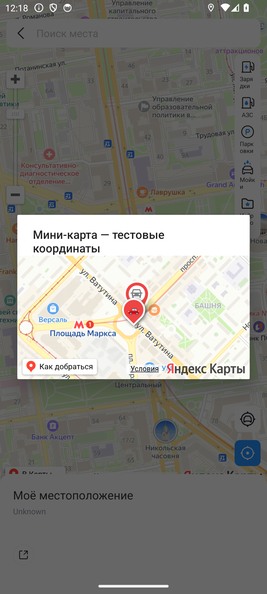

# BYD — русский интерфейс и Яндекс Карты

Неофициальная модификация Android-приложения BYD для **телефона**.
Это не прошивка автомобиля и не приложение для установки в DiLink.

В репозитории размещена только инструкция, а готовый APK — в Releases. Исходный код приложения здесь не публикуется.

## Скачать

[Скачать APK — 9.18.1 UIv4 Public1](https://github.com/hix83/BYD-RU-Yandex/releases/download/v9.18.1-uiv4-public1/BYD_9.18.1_RU_Yandex_UIv4_Public1.apk)

[Страница выпуска и файлы](https://github.com/hix83/BYD-RU-Yandex/releases/tag/v9.18.1-uiv4-public1)

В разделе Assets выбирайте файл с расширением `.apk`. Автоматические архивы GitHub «Source code» содержат только файлы этого репозитория, не исходники приложения и не установщик.

## Что изменено

- Русификация интерфейса. В изображениях и материалах с серверов BYD может оставаться китайский текст.
- Яндекс Карты на мини-карте и полноэкранной карте для отображения автомобиля и телефона.
- Ввод, замена и удаление собственного ключа Яндекс Карт в настройках.

Личный ключ автора в публичный APK не встроен. Общего или резервного ключа нет.

## Скриншоты

Мини-карта Яндекса и русифицированный раздел сообщений:

<p>
  
  
</p>

Снимки сделаны на тестовом эмуляторе. На карте — демонстрационные координаты, не местоположение личного автомобиля. Мини-карта показана в тестовом окне предпросмотра. Ниже — экраны настройки ключа публичной сборки.

## Установка

1. Скачайте APK из Releases на Android-телефон.
2. При необходимости разрешите установку из выбранного браузера или файлового менеджера. После установки разрешение можно отключить.
3. Установите приложение и войдите в свой аккаунт BYD.
4. Настройте Яндекс Карты по инструкции ниже. Для местоположения телефона предоставьте необходимые разрешения Android.

**Не удаляйте уже установленное приложение ради обновления.** Обновление с сохранением данных возможно только при совпадении подписи. При конфликте подписи остановитесь: удаление старого приложения может привести к потере локальных данных и авторизации. С официальным BYD совместимость подписи не гарантируется.

Это не второе параллельное приложение: идентификатор пакета — `com.byd.aeri.caranywhere`.

<a id="yandex-key"></a>

## Как добавить свой ключ Яндекса

1. Откройте [кабинет разработчика Яндекса](https://developer.tech.yandex.ru/).
2. Подключите **JavaScript API Яндекс Карт** и получите свой API-ключ. Ключ MapKit для этой сборки не подходит.
3. В приложении откройте вкладку **«Профиль»** и нажмите **значок шестерёнки** в верхней части экрана. В настройках выберите **«Яндекс Карты»** — первую строку списка, как на снимке ниже.
4. Вставьте ключ и нажмите **«Сохранить»**.
5. Откройте карту заново. Один сохранённый ключ применяется к мини-карте и полной карте, сохраняется после перезапуска. В том же меню его можно заменить или удалить.

### Где открыть ввод ключа

Путь: **Профиль → ⚙ Настройки → Яндекс Карты**.

**1. Откройте «Профиль» и нажмите шестерёнку в верхней части экрана.** На примере ниже она находится между значками футболки и сканера:


Это архивный снимок экрана профиля из более ранней сборки, поэтому часть подписей ещё на китайском. Для публикации аватар, ник и последние шесть цифр VIN закрыты непрозрачными плашками; изображение обезличено с помощью ИИ. Ниже показаны актуальные окна настройки ключа Public1.

**2. Нажмите строку «Яндекс Карты ›» вверху списка настроек:**


### Куда вставить ключ

В открывшемся окне **«Яндекс Карты — свой ключ»** нажмите поле **«Вставьте свой API-ключ»**, вставьте ключ из кабинета Яндекса, затем нажмите **«Сохранить»** внизу справа:


Кнопка **«Получить ключ у Яндекса»** открывает кабинет разработчика в браузере, но не создаёт ключ автоматически. Флажок **«Показать ключ»** раскрывает введённое значение — не включайте его при публикации скриншотов. На снимке поле пустое: чужой ключ копировать не нужно.

Без ключа вместо карты показывается подсказка. Вход в аккаунт BYD не заменяет настройку ключа.

Приложение проверяет формат ключа, но это не подтверждает его активацию, тариф или доступ к сервисам. Поиск организаций и другие функции требуют соответствующих подключённых API Яндекса. Если карта не загружается, проверьте ключ, интернет, подключённые сервисы и ограничения ключа.

Если вы используете ограничения HTTP Referer, базовый адрес карты в приложении:

```text
http://com.byd.aeri.caranywhere.ymapapp/
```

Допустимость этого адреса, условия использования и нужный тариф уточняйте у Яндекса. Не публикуйте свой ключ в Issues или скриншотах.

## Данные и условия использования

Ключ хранится в приватных настройках приложения на телефоне и передаётся Яндексу при работе карт. Изменение или удаление ключа не очищает аккаунт BYD, сообщения и настройки автомобиля.

Собственный ключ **не отменяет лицензионных условий Яндекса**, в том числе ограничений на мониторинг местоположения транспорта и людей. Бесплатный ключ не означает, что любой сценарий использования разрешён: проверьте применимые условия и тариф. Эта сборка не предоставляет лицензию на сторонние API.

Сборка не является официальным продуктом BYD или Яндекса. Права на исходное приложение и сторонние компоненты принадлежат соответствующим правообладателям; публикация не означает их одобрения или передачи прав.

## Совместимость и проверка

- Базовая версия: **9.18.1**, код версии **581**.
- Вариант: **UIv4 Public1**.
- Заявленный минимум базового приложения: Android 7.0 / API 24; работа на каждом устройстве не гарантируется.
- Публичная сборка проверена на Android-эмуляторе: настройка ключа, сохранение после перезапуска, загрузка обеих карт, ошибка сети и удаление ключа.
- Вход в аккаунт с реальным автомобилем на тестовом эмуляторе не проверялся. Совместимость всех телефонов, автомобилей, аккаунтов и сервисов не гарантируется; доступность данных зависит от BYD, разрешений Android и API Яндекса.

## Проверка файла

SHA-256 файла `BYD_9.18.1_RU_Yandex_UIv4_Public1.apk`:

```text
2f0b69413dca1a2c74e7f93ba2514f7441400142ff90f73706341d91744f55c1
```

Не размещайте в публичных обращениях пароль BYD, VIN, координаты, личные сообщения или API-ключ.
